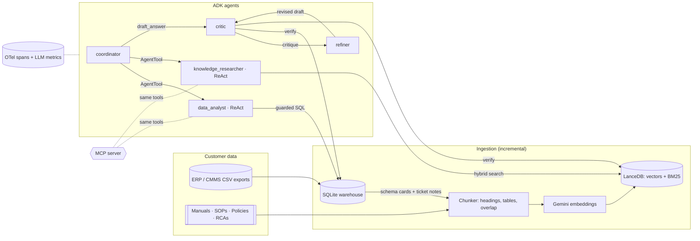

# PlantOps — a multi-agent GenAI copilot for plant operations

[](https://github.com/solknar/plantops/actions/workflows/ci.yml)

A forward-deployed-style build for a fictional manufacturer, **Northwind Fabrication** (plants in
Detroit, Houston and Austin). Plant managers and technicians ask questions like *"Which suppliers
violate our supplier agreement?"* or *"What does E-42 mean on the HX-500 and what do I do first?"*.
A team of Google ADK agents answers them from the customer's own structured data (ERP/CMMS exports)
and unstructured data (manuals, SOPs, policies, RCAs, ticket notes). Every answer is cited,
self-checked, traced and costed.

Runs locally on the **Gemini API free tier**. The only cloud dependency is an AI Studio API key.

## Where each requirement lives

| Posting requirement | Implementation |
|---|---|
| Pipelines for structured + unstructured data, vector DB, RAG | `plantops/ingest/` CSV → SQLite warehouse; Markdown/PDF → structure-aware chunks → Gemini embeddings → **LanceDB**. Incremental (content-hash manifest). Ticket free text and **schema cards** are embedded too (schema RAG for text-to-SQL). `plantops/retrieval/store.py`: **hybrid dense + BM25 with RRF fusion** and whitelisted metadata filters |
| Multi-agent systems (ADK) | `plantops/agents/graph.py`: coordinator → specialists, then a reflection loop |
| ReAct | `data_analyst` and `knowledge_researcher` run Thought → tool → observation loops with error recovery (SQL errors come back as observations, not exceptions) |
| Self-reflection | `LoopAgent[critic, refiner]`: the critic **re-verifies citations with tools** (`fetch_chunk`, `run_sql`) and calls `exit_loop` only when satisfied |
| Hierarchical delegation | The coordinator calls specialists as `AgentTool`s. It keeps control and synthesizes, and each specialist runs in an isolated child session |
| LLM-native metrics (tokens/sec, cost per request) | `plantops/telemetry/metrics.py`: ADK plugin recording per call/agent/request input/output/thinking/cached tokens, latency, TTFT (streaming), **output tokens/sec**, **list-price cost**; fleet p50/p95 |
| Optimizing state management | `ContextBudgetPlugin` elides stale tool results (keeps call/response pairing); critic/refiner use `include_contents="none"` + state templating; ADK `EventsCompactionConfig` for long sessions; persistent `DatabaseSessionService`; SQL result LRU cache; query-embedding cache |
| Detailed tracing | OpenTelemetry. ADK's own spans plus `retrieval.*`, `sql.execute`, `ingest.*` spans, persisted to SQLite and viewable as a waterfall in the dashboard; optional Cloud Trace export |
| Agentic workflows + **MCP servers** | `plantops/mcp_server.py` exposes the same guarded tools over MCP (stdio or streamable HTTP). `PLANTOPS_TOOL_TRANSPORT=mcp` makes the agents use it through ADK `McpToolset` |
| Connecting AI to the customer's systems: APIs, legacy data, security perimeters | `plantops/tools/sql.py`: read-only at the storage layer, plus a SQLite **authorizer** that allows only SELECT-shaped operations and NULLs PII columns, a timeout and a row cap. Vector-store filters are whitelisted to block injection |
| Evaluation pipelines (accuracy, safety, latency) | `plantops/evals/`: golden set whose expected answers are **computed from the warehouse**. Retrieval recall@k/MRR (offline), fact recall, citation validity, critic approval, optional LLM-as-judge, latency/cost; **CI gate** with a non-zero exit code |
| Reusable modules / best practices | Offline test suite (36 tests) using a scripted LLM, so the whole agent graph runs in CI with no API calls |

## Architecture



## Quickstart

```bash
python3.13 -m venv .venv && .venv/bin/pip install -e ".[dev]"
cp .env.example .env          # paste a free key from https://aistudio.google.com/apikey

.venv/bin/plantops ingest                       # warehouse + embeddings (incremental on reruns)
.venv/bin/plantops ask "Which suppliers are below the on-time requirement in our supplier agreement?"
.venv/bin/plantops serve                        # dashboard at http://127.0.0.1:8080
.venv/bin/plantops eval --judge                 # full eval + gate (spaced out for free-tier quotas)
.venv/bin/plantops metrics                      # fleet latency / tokens/sec / cost
```

No key yet? Everything except the LLM calls works offline. CI runs these same steps on every push
(`.github/workflows/ci.yml`) and fails the build if retrieval drops below the eval thresholds:

```bash
PLANTOPS_EMBEDDER=hash .venv/bin/plantops ingest
PLANTOPS_EMBEDDER=hash .venv/bin/plantops eval --retrieval-only
.venv/bin/python -m pytest
```

Models are set in `.env`: `PLANTOPS_WORKER_MODEL` (specialists, default `gemini-3.5-flash-lite`),
`PLANTOPS_STRONG_MODEL` (coordinator/critic/refiner, default `gemini-3.8-flash`) and
`PLANTOPS_EMBED_MODEL` (`gemini-embedding-2`). `PLANTOPS_FALLBACK_MODELS` lists models to try, in
order, when one is overloaded (503) or out of free-tier quota (429).

## Design notes

**Why hybrid retrieval.** Manufacturing questions are full of exact identifiers (`E-42`, `P-1001`,
`SOP-LOTO-001`) where dense embeddings are weakest. BM25 runs over title + section path + text,
and Reciprocal Rank Fusion merges it with dense results without having to tune score weights.
The eval caught the case that motivated indexing headings: the lockout/tagout SOP's procedure chunk
says "Seven Steps", but "Lockout/Tagout" only appears in its heading.

**Why schema cards.** Text-to-SQL fails on business semantics, not syntax: "unplanned" means
`reason_code IN ('MECH','ELEC')` and "on time" means `received_date <= promised_date`. Those rules
are captured once in discovery (`TABLE_DESCRIPTIONS`), embedded, and retrieved per question.

**Why AgentTool over transfer.** With `transfer_to_agent` the specialist takes over the conversation.
Wrapping specialists as tools keeps the coordinator responsible for synthesis, allows parallel calls,
and runs each specialist in a fresh session: it sees only its sub-task, which is cheaper and
less distracting.

**Why the critic uses tools.** A critic that only re-reads the draft mostly checks style. This one
re-opens cited chunks and re-runs key SQL, so hallucinated citations and wrong numbers get caught.
Approval comes from the `exit_loop` call, and the loop is capped by `PLANTOPS_MAX_REFLECTIONS`.

**Security perimeter in the database, not the prompt.** The SQL guard uses SQLite's authorizer, so
`SELECT *` on `technicians` works but returns NULL for email/phone, and anything that is not a read
is denied at the engine level. The MCP server reuses the same functions, so every client gets the
same guarantees.

**Metrics semantics.** `output_tokens_per_sec` = (output + thinking tokens) / generation time,
excluding TTFT when streaming. `cost_usd` uses paid-tier list prices (`config.PRICING_USD_PER_1M`,
retrieved 2026-10-27), so it shows what a customer would pay on a paid tier. On the free tier
the actual bill is $0. Requests are grouped by trace id because ADK runs each AgentTool in a child
runner with its own invocation id.

**Model fallback with a circuit breaker.** Popular free-tier models regularly return 503 under
load. `FallbackGemini` (`agents/graph.py`) gives each model a few quick retries, then moves the
request to the next model in `PLANTOPS_FALLBACK_MODELS` and puts the failed model on a 3-minute
cooldown, so later calls don't pay the same retry delay. Each switch is a span event, and
metrics record the model that actually answered, so cost stays correct.

**One `Content` per text when embedding.** `gemini-embedding-2` is multimodal: a list of plain
strings is read as parts of one input and returns a single embedding. The embedder wraps each text
in its own `Content`, and ingestion fails if the vector count doesn't match the chunk count. The
real-embedding retrieval eval caught this (recall@5 0.1 before the fix, 1.0 after).

## MCP

```bash
.venv/bin/python -m plantops.mcp_server               # stdio
.venv/bin/python -m plantops.mcp_server --http 8765   # streamable HTTP
PLANTOPS_TOOL_TRANSPORT=mcp .venv/bin/plantops ask "..."   # agents consume tools via MCP
```

Tools: `find_relevant_tables`, `list_tables`, `describe_table`, `run_sql`, `search_documents`,
`fetch_chunk`, all annotated read-only.

## Deploying to Google Cloud (free tier)

`deploy/cloud_run.sh` deploys a private Cloud Run service (scale to zero, max 1 instance), with the
Gemini key in Secret Manager and traces exported to Cloud Trace. These services have free monthly
allotments, but **you need a billing account linked** to use them. The script's header lists the
one-time setup steps.

## Production path (not built)

- Move the warehouse to **BigQuery** and swap `Warehouse` for a BigQuery client using the same
  guard approach (authorized views + column-level security for PII).
- Vector store on **Vertex AI Vector Search** or **AlloyDB/pgvector**; sessions on
  `VertexAiSessionService` or Cloud SQL. Cloud Run's local disk is ephemeral.
- Host the agent on **Vertex AI Agent Engine**; put the MCP server behind IAM.
- Propagate trace context across the MCP boundary (spans inside the MCP server process currently
  start a separate trace).
- A reranker stage, and evals that run on every PR against a frozen data snapshot.

## Layout

```
plantops/
  ingest/       chunking, embeddings, structured loader, incremental pipeline
  retrieval/    LanceDB hybrid store
  tools/        guarded SQL, tool functions shared by agents and MCP
  agents/       ADK graph, prompts, context-budget plugin
  telemetry/    OTel setup, SQLite span/metrics store, metrics plugin
  evals/        golden set + runner
  web/          dashboard
  api.py  cli.py  service.py  mcp_server.py  mcp_client.py  data_gen.py  testing.py
data/
  structured/   generated CSVs (deterministic, seed 7, data as of 2026-09-30)
  docs/         manuals, SOPs, policies, incident reports
tests/          offline suite (scripted LLM + hash embeddings)
```
